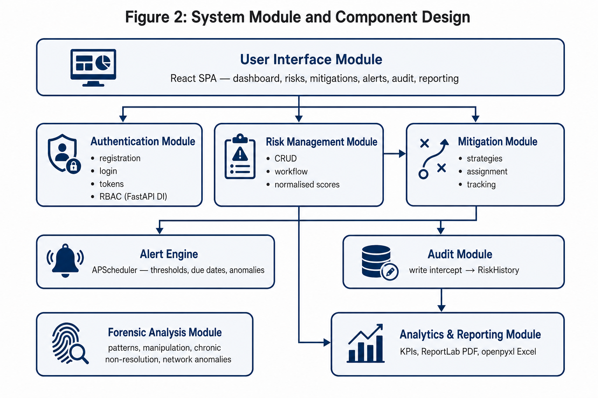

# Enterprise Risk Management System

A full-stack enterprise risk management system: organisations register risks, score them, assign mitigations, track them through controlled workflow states and report to management. Built solo.

> Not yet hosted. See **Deployment** below.



## Features
- Risk register with likelihood × impact scoring and risk levels
- Mitigation plans and owners, linked to each risk
- Departments, users and role-based access (JWT auth)
- Alerts and a scheduled background job (APScheduler)
- Dashboards and analytics (Recharts)
- PDF and Excel reports (ReportLab, openpyxl)
- Full audit trail
- Rate limiting, central exception handling, Alembic migrations, pytest test suite
- Optional Windows desktop build (Electron + bundled FastAPI)

## Tech stack
**Backend:** Python, FastAPI, SQLAlchemy (async), PostgreSQL (asyncpg) / SQLite, Alembic, Pydantic, python-jose, passlib · **Frontend:** React, TypeScript, Vite, TanStack Query, React Hook Form + Zod, Tailwind CSS, Recharts · **Ops:** Docker, docker-compose, Electron (desktop)

## Run locally
```bash
# backend
cd backend
python -m venv .venv && source .venv/bin/activate   # Windows: .venv\Scripts\activate
pip install -r requirements.txt
cp .env.example .env
uvicorn main:app --reload        # http://localhost:8000/docs
# frontend
cd ../frontend && npm install && cp .env.example .env && npm run dev
```
Or the whole stack: `docker compose up`.

## Deployment (planned, free tiers)
- **Backend + database → Render** (`render.yaml`): FastAPI web service and a Render Postgres DB.
- **Frontend → Vercel** (`frontend/vercel.json`): static Vite build with SPA rewrites. Set `VITE_API_BASE_URL` to the Render backend URL.

## Author
Tadiwanashe Muteera · tdmuteera@gmail.com
